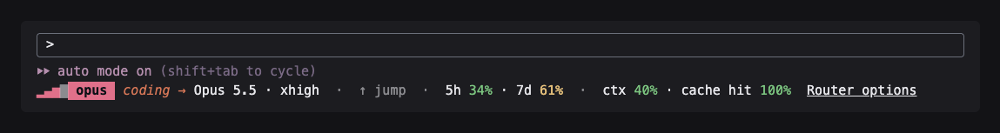
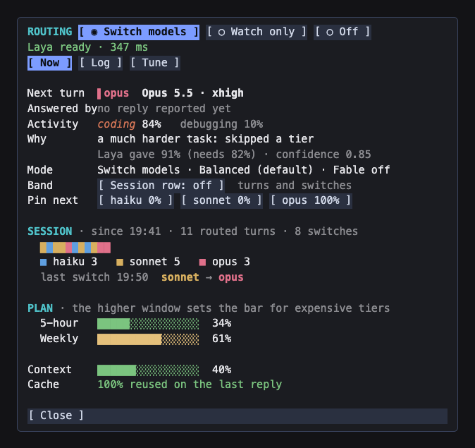
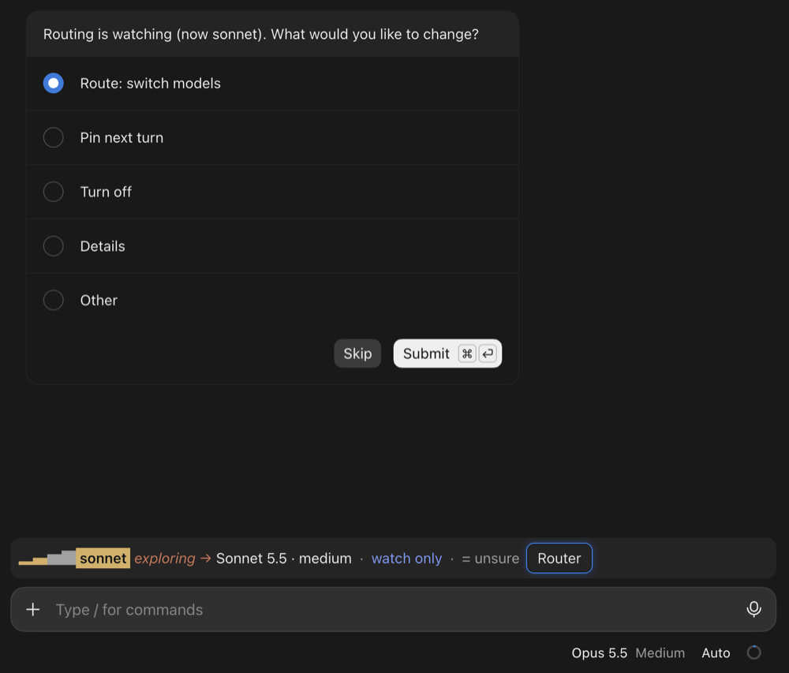
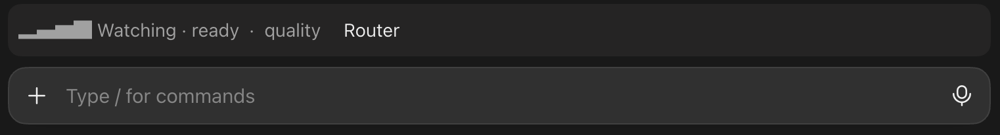

# Decision Router

A Claude Code plugin that picks the Claude model for each message, so your subscription goes further without you switching models by hand. A small decision model rates each prompt (how hard, how much code, whether it touches security), and a policy that knows your 5-hour and weekly limits turns that into Haiku, Sonnet, Opus or Fable.



## Install

In Claude Code (2.1.299 or later):

```
/plugin marketplace add frankievalentine/claude-decision-router
/plugin install decision-router@decision-router-local
```

In the Claude desktop app: Customize > Plugins, add the marketplace `frankievalentine/claude-decision-router`, then add Decision Router.

## Set up

Run `/router setup` to choose a decision model. It finds your server or asks for its address, sends one test request and saves the settings. API keys go in the plugin's settings (`/plugin` > decision-router > Configure options, or Customize > Plugins), which keep them in your system's secure credential store.

| Decision model | You need |
|---|---|
| llama.cpp | `llama-server` running a decision model |
| Unsloth | Settings > API > Decision API > Serve requests turned on |
| Cloudflare Clef | Your account ID and a Workers AI token |
| TypeSafe Jev | An API key |

For llama.cpp, download the Q8_0 build of Clef Flash (about 9.5 GB, fits a 16 GB GPU) and run:

```
llama-server -m Clef-Flash-Q8_0.gguf --port 9931 -ngl all -c 4096 -b 4096 -ub 4096 -np 1
```

## Use

The router starts in **Watch only** mode: the band shows what it would pick and why, and nothing changes. When the picks look right, run `/router route`.

| Command | What it does |
|---|---|
| `/router` | Quick menu: change mode, pin the next turn, open Status and settings |
| `/router setup`, `test` | Choose a decision model, or check that it answers |
| `/router route`, `watch`, `off` | Change the mode |
| `/router pin opus` | Run the next turn on that model |
| `/router pane` | Status and settings: the current pick, the decision log and tuning |
| `/router subagents on` | Let the router pick for subagents too (off by default) |

It switches carefully: never on a single answer, not when it would throw away a long cached conversation, and toward cheaper models as your plan limits fill. If the decision model can't be reached or isn't sure, your model stays. `/model` pauses the router. With Claude Code's `/advisor`, it never picks a model stronger than your advisor. Once the reply arrives, a check mark on the band confirms the API reported the routed model answered it.

**In the desktop app** the band sits above the prompt and appears after your first message. The app doesn't run `/router` commands: use **Router options** on the band, and the plugin's settings to choose the decision model.

## Screenshots

| Status and settings, terminal | Quick menu, desktop app |
|---|---|
|  |  |



## Privacy

Your prompt goes to the decision model you choose: it stays on your server with llama.cpp or Unsloth, and goes to Cloudflare or TypeSafe if you use them. The router's log never keeps prompt text. See the [privacy notice](PRIVACY.md).

## More

- **Update:** `claude plugin marketplace update decision-router-local`, then `claude plugin update decision-router@decision-router-local`, then restart Claude Code.
- **Reference:** [plugin/docs/REFERENCE.md](plugin/docs/REFERENCE.md) covers the switching policy, every decision model (including SGLang), every setting and the source layout.
- **Develop:** run `claude --plugin-dir ./plugin`, which hot-reloads your edits. In `plugin/`, `claude plugin test` runs the tests, `claude plugin validate .` checks the plugin, and `scripts/render-docs.sh` regenerates the terminal screenshots. Bump the version in `plugin/.claude-plugin/plugin.json` with each change, because `claude plugin update` compares versions.

MIT, see [plugin/LICENSE](plugin/LICENSE). The switching policy and the band's design build on [claude-router](https://github.com/alexei-led/claude-router) by Alexei Ledenev (MIT).
