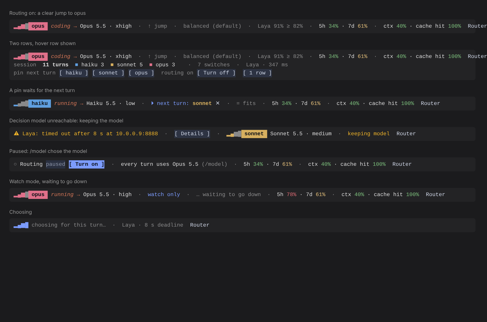

# claude-decision-router

A Claude Code mod that picks the Claude model for each turn, so you get the most out of your subscription without choosing models by hand. Inside Claude Code it is the plugin `decision-router`, and its command is `/router`.

A decision model (Cloudflare's Clef, TypeSafe's Jev, or a Clef or Laya model on your own server) describes each task: what kind of work it is, how difficult, how much reasoning it needs, whether it's security-sensitive. A switching policy then turns that into Haiku, Sonnet, Opus or Fable, weighing the prompt cache and your plan's 5-hour and weekly limits. The decision model never names a model itself.



## Install

Requires Claude Code 2.1.299 or later.

**From a local clone:**

```
git clone https://github.com/frankievalentine/claude-decision-router.git ~/claude-decision-router
```

Then in Claude Code:

```
/plugin marketplace add ~/claude-decision-router
/plugin install decision-router@decision-router-local
```

**From GitHub** (the repository is private: you need access to it, and GitHub credentials set up for git on your machine):

```
/plugin marketplace add frankievalentine/claude-decision-router
/plugin install decision-router@decision-router-local
```

Claude Code asks for the backend and its key during install and keeps the secret ones in your system's secure credential store. See [Backends](plugin/README.md#backends) for what each one needs.

## Quick start

1. Leave the router in **watch** mode for a few days: the band shows what it would pick and why, and nothing changes.
2. Type `/router` for the quick menu, or `/router pane` for the Now, Log and Tune tabs.
3. When the picks look right, switch to routing with `/router route`.

## Updating

- **Local clone:** `git pull`, then `/reload-plugins`. Claude Code reads the plugin from the folder itself.
- **From GitHub:** `claude plugin marketplace update decision-router-local`, then `claude plugin update decision-router@decision-router-local`, then `/reload-plugins` or a restart.

## Repository layout

```
.claude-plugin/marketplace.json   A one-plugin marketplace, decision-router-local, pointing at plugin/
plugin/                           The plugin: manifest, hooks module, source, tests and its full documentation
```

## Development

Run Claude Code with the plugin loaded straight from the folder, which hot-reloads your edits:

```
claude --plugin-dir ./plugin
```

Run the tests and validate the plugin:

```
cd plugin
claude plugin test
claude plugin validate .
```

The version lives in `plugin/.claude-plugin/plugin.json`. Bump it with each change you push, because `claude plugin update` compares versions.

## Documentation

[plugin/README.md](plugin/README.md) covers the rest: how a turn runs, what the band and pane show, the switching policy, every backend (including llama.cpp, Unsloth and SGLang setups), settings and keys, all `/router` commands, calibration and the source layout.

## License and credits

MIT, see [plugin/LICENSE](plugin/LICENSE). The switching policy ports ideas from [claude-router](https://github.com/alexei-led/claude-router) by Alexei Ledenev (MIT), and the band and pane follow its design.
