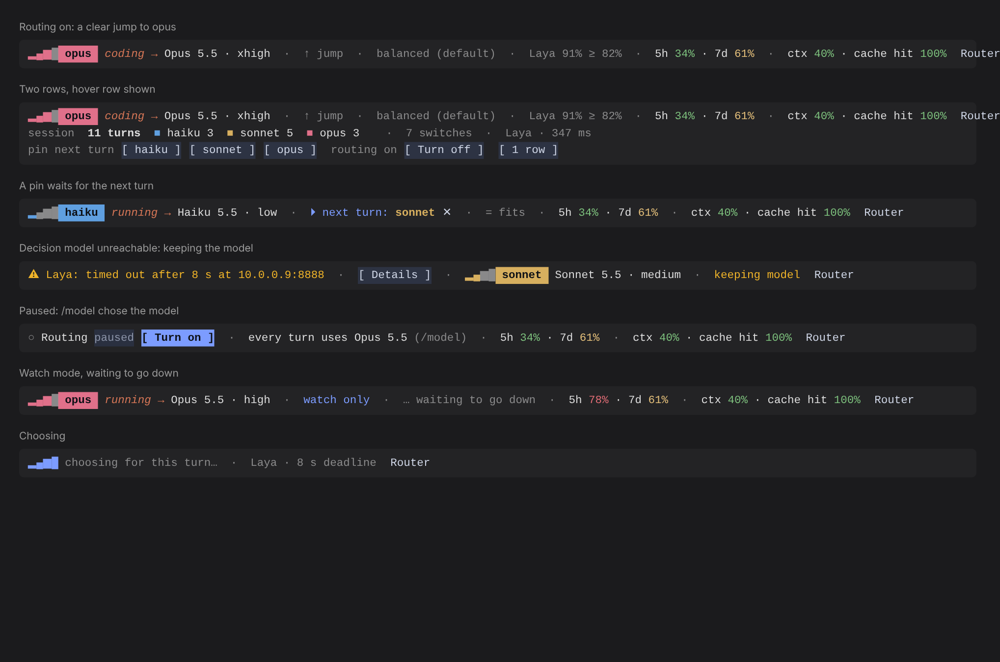
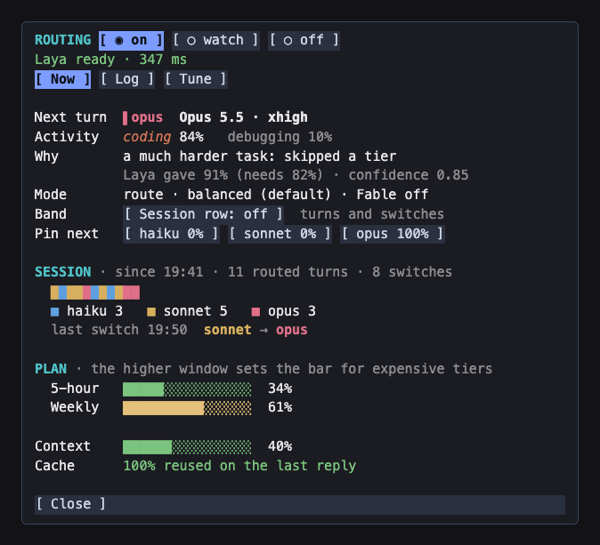

# claude-decision-router

Inside Claude Code the plugin is named `decision-router` and its command is `/router`: Claude Code reserves plugin names that start with `claude-` for Anthropic's own. It was called `router-enhanced` before 0.6; your saved mode and decision log carry over.

A Claude Code mod that picks the Claude model for each turn, so you get the most out of your subscription without choosing models by hand.

A decision model (Cloudflare's Clef or TypeSafe's Jev) **describes** each task: what kind of work it is, how difficult, how much reasoning it needs, how much code it touches, whether it's security-sensitive, and whether it continues the task already running. The router then **decides**: it turns those answers into a probability for each tier and applies a switching policy that knows about your plan's 5-hour and weekly limits.

Decision models are good at describing tasks and poor at choosing models directly (in a published paired evaluation, neither Jev nor an open-weight rival beat chance at zero-shot model routing). So the decision model never names a model here.

## How a turn runs

1. **`turn.start`**: the request to the decision model starts as soon as the turn exists, so its answer is usually ready by the first model request. A turn with no typed text (a continuation) asks nothing and keeps its route.
2. **First `turn.step`**: the answers become a tier distribution (`src/features.ts`), and the policy (`src/policy.ts`) decides whether to move.
3. **Every `turn.step`** of the main conversation runs on the chosen model and effort. Subagents keep their own models.
4. **Three tool errors in a turn** move up one tier for the rest of it, then hold for two turns.
5. **Picking a model yourself** with `/model` pauses routing for the session and records the correction.
6. **`ultrathink` is respected**: a request Claude Code raised to `xhigh` or `max` keeps that effort on whichever model the router picks.
7. **A pin** (`/router pin opus`, or the pane's buttons) runs the next turn on that tier without asking the decision model, then routing carries on where it was.

## What you see



- **The band**, on the line under the prompt, below the permission mode (`auto mode on`). In the desktop app, which has no such line, it sits above the prompt instead. Its design is claude-router's: signal bars lit up to the tier, the tier pill, the activity in orange, the model and effort, the reason (`↑ jump`, `↓ downgrade`, `= fits`, `… waiting to go up`), the decision model's evidence against the bar (`Laya 91% ≥ 82%`), your 5-hour and weekly plan usage, context fill and cache hit. Parts drop from the right as the terminal narrows; the tier and model never do.
- **The quick menu**: `/router`, or **Router** at the end of the band. A numbered question in Claude Code's own dialog, answered from the keyboard: switch between route and watch, pin the next turn (a second step asks which model), turn routing off or on, or open the details. Esc closes it without changing anything.
- **Faults lead the band**, in yellow, with where they happened: `⚠ Laya: timed out after 8 s at 10.0.0.9:8888 · keeping model`.
- **The pane** (`/router pane`, or Details in the menu), with Now, Log and Tune tabs. Every control is there too, including **Session row**, which adds a second band line with turns per tier and switches.



- **The spinner** reads "Choosing model" while the decision model answers.
- **A toast** names every model switch with its reason and evidence: `Model changed: Haiku 5.5 · low → Opus 5.5 · xhigh · jump (Laya 92% ≥ 75%)`.

## The policy

- **Evidence before switching.** A move up needs enough probability above the current tier on two consecutive turns, or one strong answer. A move down needs a clear majority on two turns, and never happens in the middle of a task.
- **The prompt cache counts.** Switching models discards the cached conversation, so the bar rises with the size of the context.
- **Plan usage.** As the higher of your 5-hour and weekly usage passes 50%, 75% and 90%, moving up gets harder and moving down easier. From 75% the top tier is Opus; from 95%, Sonnet.
- **Fable** (off by default) is used only when the decision model rates a task very hard, never for security-sensitive work, and not past 75% usage. It may bill to usage credits.
- **Security-sensitive work** runs on Sonnet or above.
- **Fails open.** A missing key, a dead server, a timeout or a low-confidence answer leaves your current model alone. Three failures in a row pause the decision model for a minute.

## Install (private)

The repository holds a one-plugin marketplace, so Claude Code prompts for your keys on install and stores the secret ones in your system's secure credential store.

1. Add the marketplace in Claude Code, from a clone (`git clone https://github.com/frankievalentine/claude-decision-router.git ~/claude-decision-router`, then `/plugin marketplace add ~/claude-decision-router`) or straight from GitHub (`/plugin marketplace add frankievalentine/claude-decision-router`; the repository is private, so this needs access to it and GitHub credentials set up for git).
2. Then: `/plugin install decision-router@decision-router-local`, and fill in the backend and its key when asked.
3. Use **watch** mode for a few days: the band shows what the router would pick and why, and nothing changes.
4. When the picks look right: `/router route`.

A clone is read in place: after `git pull`, `/reload-plugins` picks up the change. A GitHub install runs its own copy: `claude plugin marketplace update decision-router-local`, then `claude plugin update decision-router@decision-router-local`.

Requires Claude Code 2.1.299 or later (per-request model changes, and the `weight` and `tabular` text styles the band uses). Developed and tested with 2.1.317.

To work on the code instead, load the folder directly: `claude --plugin-dir ~/claude-decision-router/plugin`. Claude Code then hot-reloads your edits and writes the mods API types into `.claude-plugin/types/` for your editor. With `--plugin-dir`, set keys as `CLOUDFLARE_API_TOKEN` or `TYPESAFE_API_KEY` in your shell.

## Backends

| Backend | Calls | Needs |
|---|---|---|
| `clef-workers` (default) | Clef Flash on Cloudflare Workers AI | Cloudflare account ID and a Workers AI token |
| `jev-api` | Jev at `https://api.typesafe.ai/v1/systemone`. Jev runs only there: it has no public weights | TypeSafe API key |
| `local` | A System One server you run, default `http://127.0.0.1:8888/v1/systemone` (Unsloth) | The server, and its key if it needs one |
| `llamacpp` | llama.cpp's `llama-server` at `/v1/systemone`, default `http://127.0.0.1:9931` | A decision model such as Clef or Laya loaded in it |

All four use the same System One request format. Settings saved as `clef-local` or `jev-local` by earlier versions are read as `local`.

### Laya or Clef with Unsloth

1. In Unsloth, open Settings → API → Decision API, turn on **Serve requests**, and pick Laya or Clef.
2. For a server on another machine, turn on Unsloth's **remote LAN** access, and copy an access token (`sk-unsloth-…`). Keyless access applies to localhost only.
3. Run `/plugin`, open **decision-router** on the **Installed** tab, and choose **Configure options**:
   - `backend`: `local`
   - `local_url`: `http://<that machine>:8888/v1/systemone`, or empty on the same machine
   - `local_api_key`: the token. Keys appear only here, never on `/config`. Setting `ROUTER_LOCAL_API_KEY` in your shell also works.
   - `decision_model`: empty for the model selected in Unsloth, or `laya`
4. Close the panel; Claude Code reloads the plugin.

The router sends a small warm-up request at session start so the server loads its model before your first prompt (Unsloth takes 10 to 20 seconds the first time). Local backends wait up to 8 seconds per answer and hosted ones 2.5; `timeout_ms` overrides both. While a request is still running, no new one is sent, so a slow server never builds up a backlog.

The router ignores each server's own `confidence` field, which Unsloth computes differently from Jev, and computes confidence from the answer's probabilities, so `min_confidence` means the same thing on every backend.

### Clef or Laya with llama.cpp

`llama-server` answers System One requests itself at `/v1/systemone` when it runs a native decision model (Clef, Laya, OpenJev and others), so the router asks it the same way as the hosted backends: one request per turn with all six questions.

1. Start the server where the model runs. For a 16 GB GPU, use the Q8_0 build of Clef Flash (about 9.5 GB); the full-precision file (about 19 GB) doesn't fit, and llama-server would move part of it to system memory and shrink the context to make room.
   ```
   llama-server -m /path/to/Clef-Flash-Q8_0.gguf \
     --host 0.0.0.0 --port 9931 \
     -ngl all -c 4096 -b 4096 -ub 4096 -np 1 -fa on
   ```
   - `-ngl all` puts every layer on the GPU. With it and `-c` set, llama-server won't adjust them to fit, so a model that is too big fails to start instead of spilling into system memory.
   - `-c 4096` is enough: each router request stands alone (your prompt clipped to 6,000 characters, the last two messages, the six questions), about 3,000 tokens at most, and nothing builds up over a session.
   - `-b 4096 -ub 4096`: Clef and Laya evaluate the whole request in one batch, and the default of 512 tokens is too small.
   - `-np 1`: the router sends one request at a time. `-fa on` saves memory; drop it if your GPU backend rejects it.
   - Leave out the `mmproj` file: it is Clef's image projector, and the router sends text only. With `-hf` instead of `-m`, add `--no-mmproj`, because `-hf` loads it automatically.
   - `--host 0.0.0.0` lets another machine reach it; add `--api-key <key>` to require a key.
2. In `/plugin` → **Installed** → **decision-router** → **Configure options**:
   - `backend`: `llamacpp`
   - `local_url`: `http://<that machine>:9931`, or empty on the same machine. The host and port are enough.
   - `local_api_key`: the `--api-key` value, if you set one
   - `decision_model`: empty for a single-model server; the model's name on a server that hosts several
3. Close the panel, send a prompt, and check `/router log`. llama.cpp's own messages come through: `too large to process. increase the physical batch size` means raising `-b` and `-ub`, and `llama-server is not running a decision model` means the loaded model can't answer `/v1/systemone`.

### Clef with SGLang

Set `backend` to `local`, `local_url` to `http://127.0.0.1:30000/v1/systemone`, and `decision_model` to `Cloudflare/clef-flash` or `Cloudflare/clef`.

## Settings and keys

- **All settings, keys included:** `/plugin` → **Installed** → **decision-router** → **Configure options**.
- **Settings without keys** also appear on `/config` under decision-router. Claude Code never shows sensitive settings there.
- **Keys from the shell**, if you prefer: `CLOUDFLARE_API_TOKEN`, `TYPESAFE_API_KEY` or `ROUTER_LOCAL_API_KEY`.
- **Clearing a key:** the key fields can be replaced but not emptied, so enter `none` in one to clear it. `none` also stops the router from falling back to the shell variable.

## Commands

- `/router`: the quick menu (or the status as text where no one can answer it). Unknown words print the list of commands
- `/router pane`: the pane with Now, Log and Tune
- `/router status`: the status as text, with the last decision-model error
- `/router route | watch | off | on`: change the mode (remembered across sessions)
- `/router pin haiku | sonnet | opus | fable`: run the next turn on that tier
- `/router log [n]`: the last decisions, with difficulty, confidence and corrections
- `/router tune`: tier mix, how often you corrected the router up or down, decision-model latency, and which way to adjust

## Calibration

Every decision is journaled (labels and numbers only, never prompt text) with what happened next: a manual override up or down, or an escalation. `/router tune` turns that into a suggestion. The weights and thresholds live at the top of `src/features.ts` and `src/policy.ts`, and the tests in `tests/core.test.ts` pin the behavior you'd want to keep while changing them.

## Layout

```
hooks/router.ts      Claude Code events in, decisions out. The only file that calls the mods API.
src/features.ts      Answers to a tier distribution
src/policy.ts        When to switch; plan-usage gate; escalation
src/classifier.ts    Backends and the System One wire format
src/journal.ts       Decision log and tuning
src/tiers.ts         Models, efforts, availability fallback
src/view.ts          The band and the pane (claude-router's design)
tests/               claude plugin test: unit tests and end-to-end tests of the hooks module
```

Run the tests with `claude plugin test` and check the module with `claude plugin validate .`.

## Credits

The switching policy ports ideas from [claude-router](https://github.com/alexei-led/claude-router) by Alexei Ledenev (MIT): vote streaks, a cache-loss bar, holds after escalation, and no cheaper move mid-task. The band and pane follow its design.
