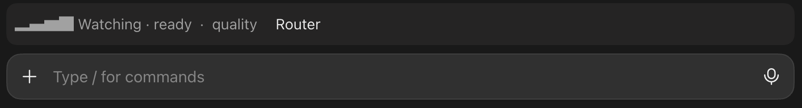

# Decision Router

Decision Router picks the right Claude model for every message you send in Claude Code, so your plan lasts longer and you never have to switch models yourself.

Quick questions go to a fast, light model. Hard problems go to a stronger one. As your 5-hour and weekly limits fill up, it leans toward lighter models, so you don't run out halfway through the day.

## How it works

1. **A small decision model reads your message** and rates it: how hard it is, how much code it touches, and whether it's security work. It never chooses a model itself.
2. **The router picks Haiku, Sonnet, Opus or Fable** from that rating, your plan usage, and what you're already working on.
3. **Claude answers on that model.** A short note tells you whenever the model changes, and why. Once the reply arrives, a check mark confirms the API reported that model answering it; if a different model answered, the router says so.

It's careful about switching. It won't change models on a single message, it stays put in the middle of a task, and if the decision model can't be reached, your current model simply stays.

## Getting started

1. Install Decision Router. In Claude Code, run `/plugin install decision-router --marketplace frankievalentine/claude-decision-router`. In the desktop app, open Customize > Plugins, add the marketplace `frankievalentine/claude-decision-router`, then add Decision Router.
2. Run `/router setup` and choose where the decision model runs: on a hosted service (Cloudflare or TypeSafe) or on your own computer (llama.cpp, Unsloth or SGLang). Add any key it needs in the plugin's settings.
3. Use it as usual. It starts in **Watch only** mode: it shows what it would pick and changes nothing.
4. When the picks look right, run `/router route` to let it switch models for you.

Type `/router` at any time for a quick menu: switch modes, choose the model for your next message, or open the details panel.

## Works in the terminal and the desktop app

Decision Router works wherever Claude Code runs: the terminal, your editor, and the Code tab of the Claude desktop app. In the desktop app, its status line appears above the prompt after your first message.

The desktop app doesn't run `/router` commands. Click **Router** at the end of the status line for the quick menu and the details panel, and choose the decision model and add keys in the plugin's settings (Customize > Plugins). The model picker under the prompt keeps showing the model you chose for the session: the router changes the model one message at a time, and the check mark on the status line confirms which one answered.

It also works alongside Claude Code's `/advisor`: it never picks a model stronger than your advisor, so the advisor keeps working.

## Screenshots

### Claude Code (terminal)

The band under the prompt, with the model the router picked and why:

The details pane (`/router pane`): the current pick, plan usage, the decision log and tuning:

### Claude desktop app

The band above the prompt in the Code tab, after the first message of a session:

The quick menu, opened with **Router** at the end of the band:

## What it sends, and where

- **Your message goes to the decision model you choose**, so it can rate the task. With llama.cpp, Unsloth or SGLang, it stays on your own computer or network. With Cloudflare or TypeSafe, it's sent to that service.
- **If you turn on subagent routing** (`/router subagents on`, off by default), the task Claude gives each general subagent is sent the same way.
- **Nothing else leaves your machine.** The router's own log keeps labels and numbers only, never the text of your messages.
- **Keys stay in your settings.** API keys are entered only in the plugin's settings, where Claude Code stores them in your system's secure credential store. The plugin never reads keys from your environment.

See the [privacy notice](https://github.com/frankievalentine/claude-decision-router/blob/main/PRIVACY.md) for details.

## Learn more

The [reference](docs/REFERENCE.md) covers every setting, each decision-model option in detail, the switching rules, and how the code is laid out.

MIT licensed. The switching rules build on [claude-router](https://github.com/alexei-led/claude-router) by Alexei Ledenev.
