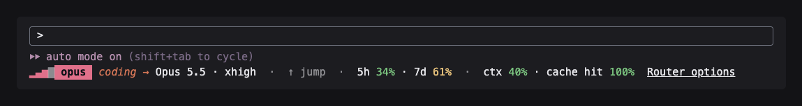
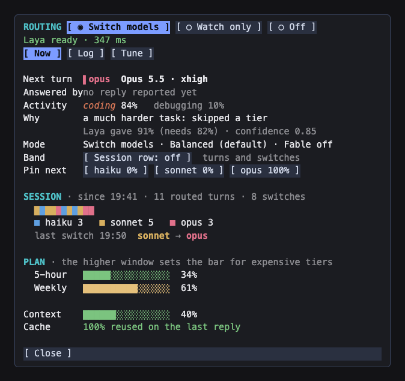
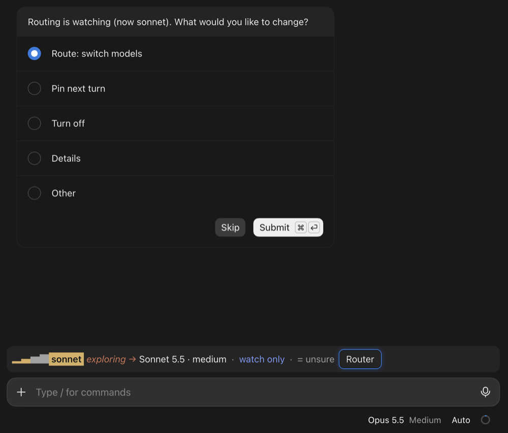

# Decision Router

Decision Router picks the right Claude model for every message you send in Claude Code, so your plan lasts longer and you never have to switch models yourself.

Quick questions go to a fast, light model. Hard problems go to a stronger one. As your 5-hour and weekly limits fill up, it leans toward lighter models, so you don't run out halfway through the day.

## How it works

1. **A small decision model reads your message** and rates it: how hard it is, how much code it touches, and whether it's security work. It never chooses a model itself.
2. **The router picks Haiku, Sonnet, Opus or Fable** from that rating, your plan usage, and what you're already working on.
3. **Claude answers on that model.** A short note tells you whenever the model changes, and why. Once the reply arrives, a check mark confirms the API reported that model answering it; if a different model answered, the router says so.

It's careful about switching. It won't change models on a single message, it stays put in the middle of a task, and if the decision model can't be reached, your current model simply stays.

## Getting started

1. Install Decision Router. In Claude Code, run `/plugin install decision-router --marketplace frankievalentine/claude-decision-router`, which adds the marketplace and installs the plugin in one step. In the desktop app, open Customize > Plugins, add the marketplace `frankievalentine/claude-decision-router`, then add Decision Router.
2. Run `/router setup` and choose where the decision model runs: on a hosted service (Cloudflare or TypeSafe) or on your own computer (llama.cpp, Unsloth or SGLang). Add any key it needs in the plugin's settings.
3. Use it as usual. It starts in **Watch only** mode: it shows what it would pick and changes nothing.
4. When the picks look right, run `/router route` to let it switch models for you.

To get each new version automatically, turn on auto-update: run `/plugin`, open **Marketplaces**, select `decision-router-local`, then **Enable auto-update**. It's off by default.

Type `/router` at any time for a quick menu: switch modes, choose the model for your next message, or open **Status and settings**.

## Works in the terminal and the desktop app

Decision Router works wherever Claude Code runs: the terminal, your editor, and the Code tab of the Claude desktop app. In the desktop app, the status line appears above the prompt after your first message. The app doesn't run `/router` commands, so click **Router options** on the status line instead, and choose the decision model in the plugin's settings (Customize > Plugins).

The model picker keeps showing the model you chose for the session, since the router changes the model one message at a time. A check mark on the status line confirms which model answered. It also works alongside Claude Code's `/advisor`: it never picks a model stronger than your advisor.

| Status and settings, terminal | Quick menu, desktop app |
|---|---|
|  |  |

## What it sends, and where

- **Your message goes to the decision model you choose**, so it can rate the task: its first 6,000 characters, with the last two messages of the conversation (500 characters each, Claude's replies included) so it can tell a follow-up from a new task. With llama.cpp, Unsloth or SGLang, it stays on your own computer or network. With Cloudflare or TypeSafe, it's sent to that service.
- **If you turn on subagent routing or watching** (`/router subagents on` or `watch`, both off by default), the task Claude gives each general subagent is sent the same way.
- **Fixed requests:** with a server on your own computer or network, a short warm-up request when a session starts; `/router setup` and `/router test` send one fixed sample task. Neither contains anything you typed.
- **Nothing else leaves your machine.** The router's own log keeps labels and numbers only, never the text of your messages.
- **Keys stay in your settings.** API keys are entered only in the plugin's settings, where Claude Code stores them in your system's secure credential store. The plugin never reads keys from your environment.

See the [privacy notice](https://github.com/frankievalentine/claude-decision-router/blob/main/PRIVACY.md) for details.

**The only hosts it contacts** are the decision model you choose: `api.cloudflare.com` (Workers AI, under your own account), `api.typesafe.ai`, or the address of your own server (by default `127.0.0.1:9931` for llama.cpp and `127.0.0.1:8888` for Unsloth). It downloads nothing and runs no commands or programs.

## What it does inside Claude Code

Decision Router is a hooks module: code that Claude Code runs at set points. Here is each point it uses, and what it changes there.

- **Each model request** (`turn.step`). In **Switch models** mode, it sets the request's model and effort to the router's pick; in **Watch only** it changes nothing. With subagent routing on, it does the same for each request of a general or Explore subagent. It reads the model the reply came from, the share of the prompt cache reused, and whether the advisor was consulted.
- **Each prompt you send** (`turn.start`). It sends the prompt to the decision model, as described above. The prompt itself goes on to Claude unchanged.
- **Tool calls** (`tool.call`). It counts failed calls, so repeated errors can move the turn up a model. Every call goes on unchanged.
- **Subagents starting** (`agent.spawn`). Every subagent starts exactly as Claude asked. With subagent routing on, the router reads the subagent's task to pick its model, which it then sets on the subagent's requests.
- **`/model` and `/advisor`** (`command.run`). Both run unchanged. Picking a model with `/model` pauses routing for the session; after `/advisor` the router reads the new advisor setting.
- **Reading settings** (`settings.read`). Choices saved by versions before 0.12 are shown under their new labels, so they keep working. The settings file itself is not changed.
- **Drawing** (`ui.render`). It adds the status line by the prompt, the words "Choosing model" on the spinner while the decision model answers, and the Status and settings panel. Everything Claude Code draws itself is left as it is.
- **Session start** (`session.start`). It adds the `/router` command, loads its saved choices and, for a server on your network, sends the warm-up request.
- **Usage readings** (`session.measure`) and **turn ends** (`turn.complete`). It reads plan usage and context fill for the policy and the band, and saves a subagent's record when it finishes. Nothing is changed.

**Settings it changes:** only its own, and only when you ask. `/router setup` saves the decision model, server address and Cloudflare account ID you choose, and the Fable switch in Status and settings saves **Use Fable**. It never changes Claude Code's own settings, permission mode or Remote Control, and sets no environment variables.

**Environment variables it reads:** `CLAUDE_CODE_SUBAGENT_MODEL` and `CLAUDE_CODE_SUBAGENT_MODEL_FORCE`, so subagent routing respects a model you set for subagents, and `CLAUDE_CODE_DISABLE_ADVISOR_TOOL`, so an advisor you turned off is not counted. Nothing else, and no keys.

**What it keeps:** in Claude Code's plugin storage on your computer, your mode, the panel's choices (session row, Fable switch), the subagent mode, and a decision log and subagent log of labels and numbers.

## Learn more

The [reference](docs/REFERENCE.md) covers every setting, each decision-model option in detail, the switching rules, and how the code is laid out.

MIT licensed. The switching rules build on [claude-router](https://github.com/alexei-led/claude-router) by Alexei Ledenev.
